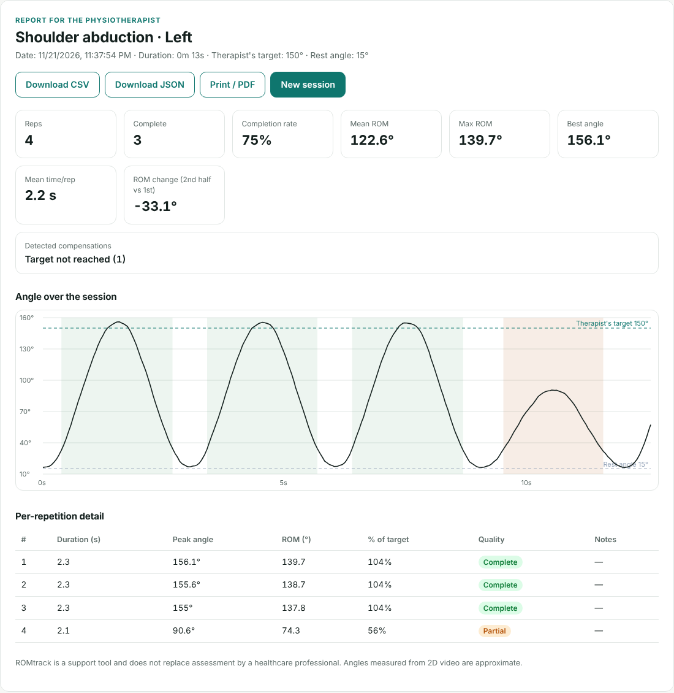

# ROMtrack

**Rehabilitation exercise tracking from a webcam, entirely in the browser.**
ROMtrack counts repetitions, measures range of motion (ROM) and flags common compensations during physiotherapy exercises. At the end of the session it produces a report the patient can hand to their physiotherapist. The video never leaves the device.

**▶ Live demo: [jgs.github.io/Romtrack](https://jgs.github.io/Romtrack/)** (allow camera access; nothing is uploaded)



> ⚠️ ROMtrack is a support tool, not a medical device. Angles measured from 2D video are approximate and do not replace assessment by a healthcare professional.

## Why

Most physiotherapy happens at home, unsupervised. Patients don't know if they're reaching the prescribed range, they compensate without noticing, and the therapist only hears "it went fine". ROMtrack turns a laptop camera into an objective log of every repetition:

- **Patient**: live rep counter, a progress bar towards the therapist's target, and immediate feedback ("trunk lean", "elbow bent", "too fast").
- **Physiotherapist**: a per-session report with ROM per rep, completion rate, fatigue drift and detected compensations, exportable as PDF, CSV or JSON.
- **Privacy by design**: pose estimation runs on-device (WebAssembly/WebGPU). No server, no accounts, no uploads.

## Features

| | |
|---|---|
| **6 exercises** | Shoulder abduction, shoulder flexion, elbow flexion, seated knee extension, mini squat, standing hip abduction |
| **Configurable target** | The therapist sets the target angle per patient; the rest angle can be calibrated live |
| **Robust rep counting** | One Euro filtering + hysteresis state machine (see [Benchmark](#benchmark)) |
| **Compensation detection** | Trunk lean, shoulder hiking, elbow bent, upper-arm swing, knee valgus, leg asymmetry, knee bent, too fast |
| **Report** | Summary cards, angle-over-time chart with reps shaded by quality, per-rep table, print-to-PDF, CSV/JSON export |
| **History** | Past sessions kept locally in the browser to track progress over weeks |
| **Sources** | Live camera or a recorded video file |
| **i18n** | Spanish and English |

## How it works

```
camera / video ──► MediaPipe Pose Landmarker (33 landmarks, on-device)
                    │
                    ▼
        exercise.measure(landmarks, side)
        ├─ joint angle (e.g. hip–shoulder–elbow)
        └─ per-frame compensation checks
                    │
                    ▼
        One Euro filter (adaptive low-pass on the angle)
                    │
                    ▼
        RepCounter (hysteresis on normalised progress rest→target)
        ├─ rep start / end, peak angle, ROM, duration
        ├─ complete vs partial (≥ 90 % of target)
        └─ compensations kept only if present in ≥ 20 % of the rep's frames
                    │
                    ▼
        live HUD + feedback ──► session summary ──► report / export
```

Design decisions:

- **Progress normalisation.** Angles are mapped to `progress = (angle − rest) / (target − rest)`, so the same counter handles movements where the angle increases (abduction, knee extension) and decreases (elbow flexion, squat).
- **Hysteresis instead of a single threshold.** A rep starts above 30 % and only closes below 15 %. Jitter around a threshold cannot produce double counts.
- **One Euro filter** ([Casiez et al., CHI 2012](https://gery.casiez.net/1euro/)). It smooths heavily when the limb is still and adds little lag when it moves fast, which a fixed moving average can't do.
- **ROM from the most rested angle** of each rest phase, not from the band edge, so ROM isn't underestimated.
- **Pure core, thin UI.** Everything in `src/core/` is DOM-free and unit-tested in Node; the browser layer only wires camera, model and rendering.

## Benchmark

`npm run bench` evaluates the counting pipeline on **synthetic** angle trajectories with known ground truth: 500 sets × 10 reps per noise level, 30 fps, Gaussian noise σ, 1 % outlier spikes of ±25° and 20 % deliberately partial reps.

| Noise σ | Pipeline | Sets counted exactly | Count error | Complete/partial accuracy | Peak-angle MAE |
|---|---|---|---|---|---|
| 2° | raw + hysteresis | 92.2% | 0.8% | 99.7% | 6.4° |
| 2° | One Euro + hysteresis | 100.0% | 0.0% | 100.0% | 2.5° |
| 4° | raw + hysteresis | 88.8% | 1.2% | 99.5% | 9.4° |
| 4° | One Euro + hysteresis | 100.0% | 0.0% | 100.0% | 3.9° |
| 6° | raw + hysteresis | 80.8% | 2.2% | 99.8% | 12.7° |
| 6° | One Euro + hysteresis | 100.0% | 0.0% | 100.0% | 5.7° |
| 8° | raw + hysteresis | 53.2% | 6.3% | 99.3% | 16.1° |
| 8° | One Euro + hysteresis | 100.0% | 0.0% | 100.0% | 7.6° |

Filtering keeps the count exact up to σ = 8°. Without it, exact sets drop to 53 % and peak-angle error doubles.

**What this does and doesn't show.** The benchmark validates the signal-processing logic. It does **not** measure pose-estimation error on real bodies, the camera-angle effects of 2D projection, or agreement with a goniometer. See [Validation](#validation).

## Validation

Planned real-world validation (contributions welcome):

- [ ] Rep-count accuracy on recorded sessions with manually labelled reps
- [ ] Peak-angle agreement against a manual goniometer (Bland–Altman)
- [ ] Sensitivity of each compensation check (labelled clips)
- [ ] Effect of camera angle and distance on measured ROM

## Run locally

No build step and no dependencies. The model is fetched from the MediaPipe CDN on first load.

```bash
git clone https://github.com/jgs/Romtrack.git
cd Romtrack
npm start            # or: python3 -m http.server 8000
# open http://localhost:8000
```

Camera access requires `localhost` or HTTPS.

```bash
npm test             # 15 unit tests (Node ≥ 18, built-in test runner)
npm run bench        # synthetic benchmark table above
```

## Project structure

```
index.html            UI shell
css/styles.css        styles (+ print stylesheet for the PDF report)
src/app.js            camera/video, MediaPipe, render loop, HUD
src/report.js         report, chart, exports, local history
src/i18n.js           Spanish / English strings
src/core/geometry.js  joint angles, trunk tilt
src/core/oneEuro.js   One Euro filter
src/core/repCounter.js  hysteresis repetition counter
src/core/exercises.js exercise catalogue + compensation checks
src/core/session.js   summary statistics, CSV, downsampling
test/                 unit tests + synthetic trajectory generator
scripts/benchmark.js  counting benchmark
```

## Roadmap

- Per-patient exercise plans shared by the therapist via link
- Hold-time tracking for isometric exercises
- 3D world landmarks to reduce camera-angle dependence
- Bilateral comparison (injured vs healthy side)

## Tech

Vanilla JavaScript (ES modules) · MediaPipe Tasks Vision (Pose Landmarker lite) · Canvas 2D · Web Audio · Node test runner · GitHub Actions.

## License

MIT © [jgs](https://github.com/jgs)
